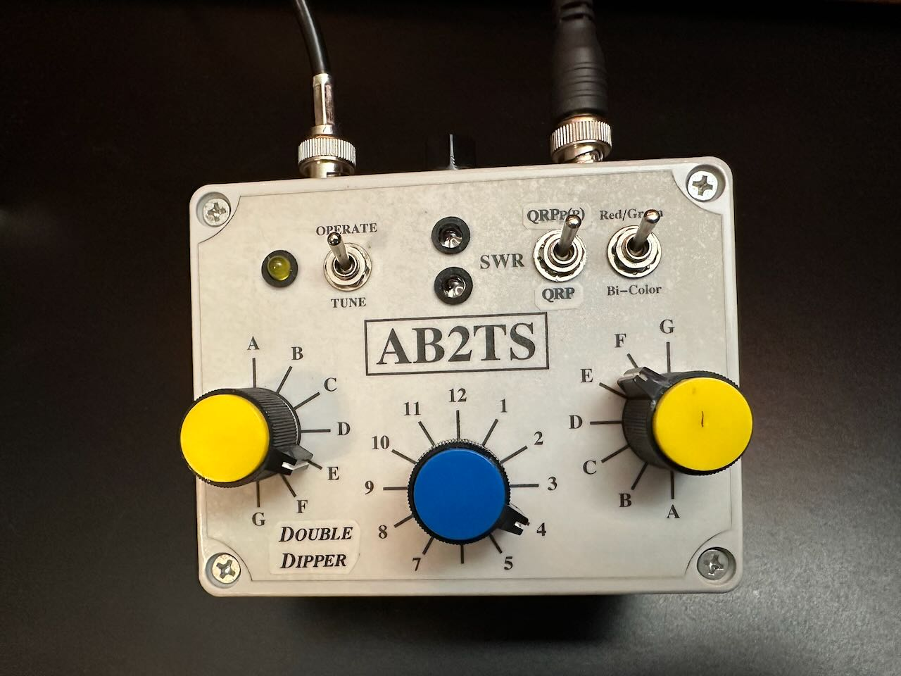

# AB2TS Double Dipper QRP/QRPp/QRPpp LED SWR Bridge

## By Michael Sciascia, AB2TS

I often operate a WSPR beacon at power levels well below 100mW; sometimes as low as 20mW. Tuning an antenna at these power levels is can be difficult as the transmitter does not provide sufficent power to satisfactorily illuminate the LED in the familiar passively powered QRP SWR bridge. When driven with very low power, the familiar QRP resistive SWR bridge will often drop of into a very wide information black-out: if the LED manages to illuminate at all.

The resistive QRP/QRPp(p) SWR bridge presented is the result of many design iterations and 8 years of regular operation in its final form. The bridge's unique feature is that it has two distinct SWR indicator circuits that work together to create an LED SWR tuning indicator that works down to 10mW.

The first indicator circuit is the familiar passive QRP resistive SWR bridge that we have all become accustomed to over the past 20+ years. This circuit is typically effective at transmitter power levels of say 300mW(+/-) to 10W. It works by taking advantage of the available power at the bridge due to the antenna mis-match. The mis-match power is used to illuminate an LED. If there is no mismatch there is no LED illumination and you have found the SWR sweet spot. This circuit's primary failing is that at very low power levels the LED indicator may not illuminate at all even with a very bad match. If the LED does manage to partially illuminate, the indicative "dip" of the LED often encompasses a wide tuning range that does not pinpoint the best antenna match.

The second indicator circuit employed by the Double Dipper is an active design with substantial gain that kicks in when the LED of the first circuit is dim. This is normally indicative of a successful dip or perhaps that the transmitter has insufficient power to illuminate the passive circuit's LED. At this point the second high gain circuit takes over and provides a supplemental tuning dip.

I used a red LED (QRP) as the first/passive circuit dip indicator and a green LED (QRPpp) for the second/active circuit dip indicator. The design coordinates the LEDs so that only one LED is illuminated at any time. During the process of tuning an antenna you will see in sequence that; the red LED illuminates initially due to an unmatched condition, then it dips as you approach a match. Given that the red LED (QRP) is dipped/dark, the second circuit is activated and the green LED (QRPpp) illuminates. You may continue to fine tune the match until the green LED also dips. Hence, the name DOUBLE DIPPER.

## Video Demonstration of the Double Dipper

## Here are some operating cases

- At higher power levels that are well into the typical QRP range, the green LED may never dip even though the red one does. This is because the residual mismatch power does not drop below the threshold point where the sensitive circuit recognizes a match condition. The circuit is actually overwhelmed by the excess of mismatch power and the green LED stays on. In this case a switch is provided to turn off the green LED. (I often leave the green LED on as it now illuminates as an indication of a successful dip.)
- At very low power levels, the red LED (QRP) may not illuminate at all. At this point the green LED (QRPpp) is active and provides the desired dip indication.
- At very very low power levels, say less than 10mW, the green LED will dip but as before the dip will be wide and will not point to a precise match condition.
- If the battery for the active second circuit fails (QRPpp), the first circuit (QRP) will continue to function as it is an entirely passive circuit.

## Some circuit details

- The schematic does contain a representative tuning circuit. However, it is not intended to provide a well designed universal matching network. Substitute your own favorite matching network, or integrate the Double Dipper into an existing antenna tuner.
- The schematic shows a 3PDT switch to toggle the resistive bridge in and out of the tune/operate positions. The extra pole in the switch is used to turn off the active portion of the SWR indicator when the tune/operate switch is in the operate condition. 3PDT switches are hard to source so I used a 4PDT toggle as it was easy to find and relatively inexpensive. You can use a DPDT toggle but you will need a separate switch to turn the power off. I included a flashing yellow LED in my circuit as a reminder that I was still in the tune position and draining the battery. The schematic shows some un-necessary multi-pin connectors. My prototype (and now my operational unit) went through many design iterations. I used the connectors to enable fast design evolutions with a remove and replace circuitboard without having to re-wire the entire unit. You can omit the connectors.
- Switching of the LEDs: I couldn't decide if I preferred two separate LEDs or a single combined red/green LED so I added a switch to facilitate evaluation of the options. Both of my LEDs are the same high brightness common cathode red/green LEDs. Having the same LEDs in both positions eliminated variation in illumination between the two LEDs as a factor. I recommend using a single two color LED rather than two separate LEDs. (Although there are times when I find using two LEDs is helpful.)
- Three transistors and a voltage regulator form the active part of the circuit for QRPp(p) operation. The two 2N3906 PNP transistors form a darlington pair which provides rectification and lots of gain to drive the green LED. The 2N7000 transistor shorts out the green LED when the red LED is illuminated. I am sure there is a fancy way to open the circuit to disable the green LED rather than shorting it, but I wanted to limit the parts list to only junk box parts. This was my compromise. Arguably the voltage regulator is not necessary but is recommended.
- Resistors R1 and R4 were located under on the top panel next to the LEDs. This permitted quick adjustment of the LED brightness. I used super bright LEDs. Ultimately R1 was just shorted out. R4 may be rolled into R3 to reduce the part count. However, DO NOT ROLL R3 INTO R4! R3 must have significant resistance to prevent a direct short circuit.
- The schematic shows an un-necessary 1N4148 diode and a 0.01uF disk capacitor. The were used in one of the previous evolutions to show a relative power output. You may ommit these parts.
- You can use 1k resistors everywhere a 910R resistor is called out. I picked up a ton them surplus so that is a go-to value for me.

## Schematic Diagram

Find the Double Dipper schematic here:  [Visit GitHub](./AB2TS_Double_Dipper_RevE.bmp)

Copyright 2026 by Michael Sciascia. All rights reserved.

This work is licensed under
Creative Commons BY-NC-SA 4.0 / Attribution-NonCommercial-ShareAlike 4.0 International.
https://creativecommons.org/licenses/by-nc-sa/4.0/.  

